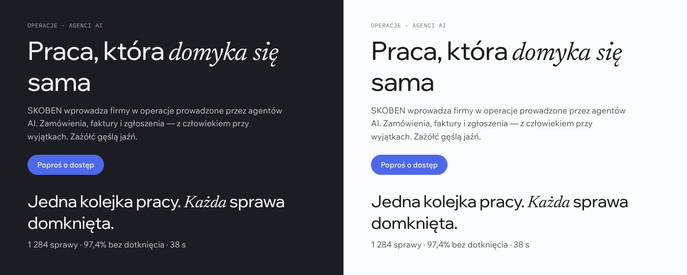
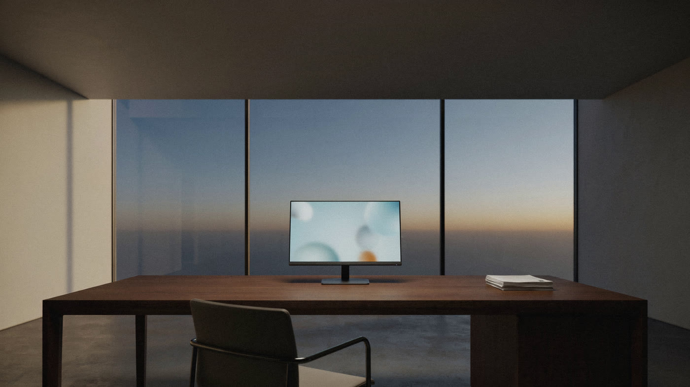
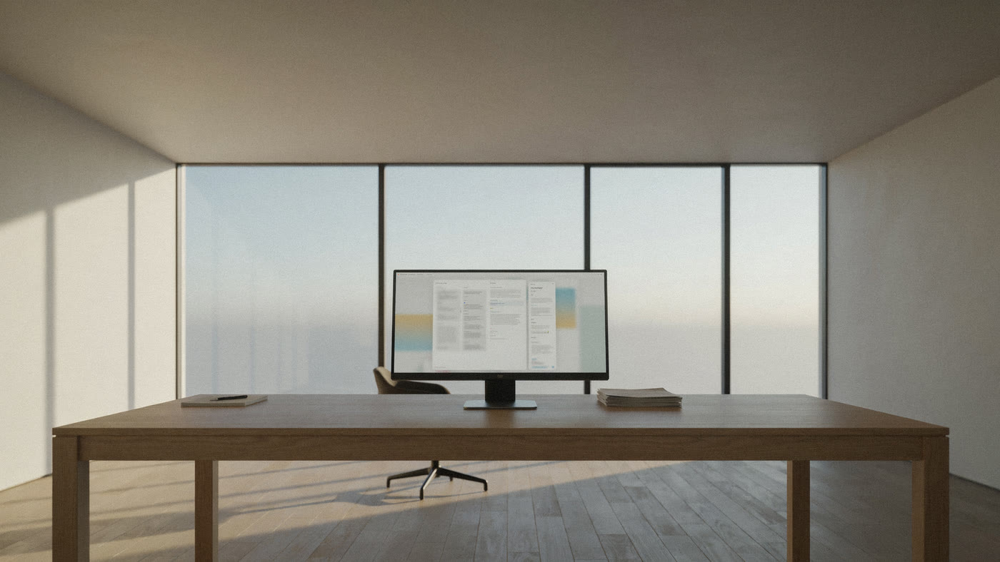
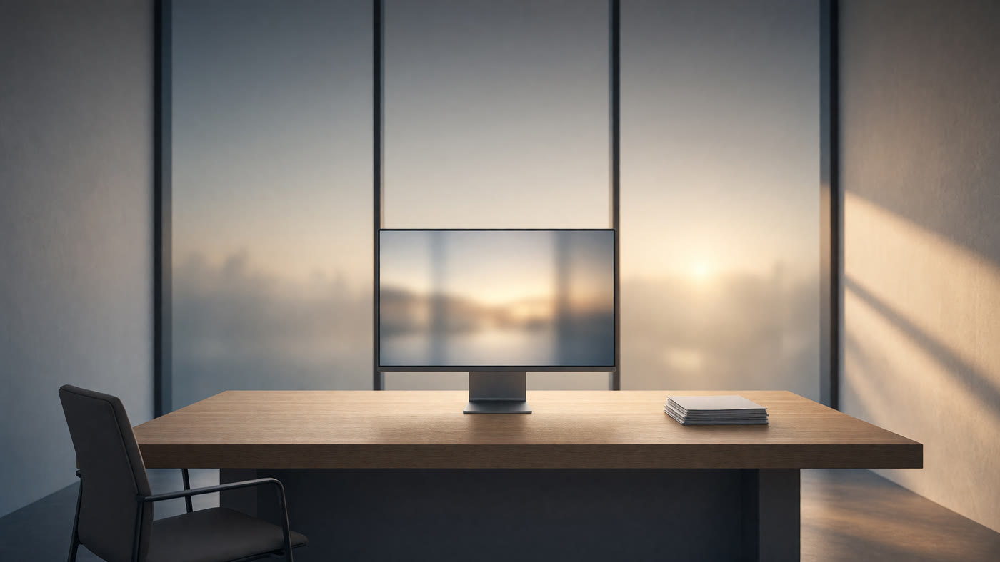

# Kierunek artystyczny SKOBEN — iteracja 3

Stan: 2026-11-15. Dokument zastępuje założenia iteracji 1–2 („zero grafik”, jedna konsola w wielu skalach, brama).
Źródła: brief właściciela (karta `kono-state/tasks/T-WEB-SKOBEN-001.md`), studium wzorca
([`art-direction/mercury-study.md`](art-direction/mercury-study.md), 91 zrzutów w `art-direction/ref/`),
kadry wygenerowane na koncie właściciela (`art-direction/candidates/generated/`) i kandydaci ze stocków
(`art-direction/candidates/`).

## 1. Co bierzemy ze wzorca, a czego nie

Bierzemy **system**, nie wygląd:

| Zasada wzorca | Jak ją stosujemy |
|---|---|
| Strona jest jednym ujęciem: zdjęcie → najazd kamery → ekran staje się żywym interfejsem | Własna scena (biuro o błękitnej godzinie), ten sam łańcuch: film sterowany przewijaniem → ekran monitora staje się czytelną konsolą |
| Jedna rodzina kroju w dwóch odmianach, wąski zakres grubości, małe nagłówki | Wix Madefor Display / Text, grubości 400–500; h1 49 px przy 1440, 28 px przy 390 |
| Trzy tła przenikające się na całej stronie | Atrament `#1c1c23`, ciepła biel `#f6f4ef`, chłodna biel `#fbfcfd`; zmiana 500 ms, razem z nawigacją |
| Jeden akcent użyty kilka razy | Wirydian `#2a6b5c` — tylko główny przycisk, kropka aktywnej pozycji i obrys fokusu |
| Płaskie kafle 12 px, podpis pod kaflem, żadnych cieni ani ramek | To samo; cień zostaje wyłącznie pod konsolą po najeździe |
| Mało ruchu: scrub w hero, pętle w kaflach z pauzą, taśma | To samo; jedno wejście sekcji 670 ms, bez liczników i paralaksy |

Nie bierzemy: treści, zdjęć, krojów (Arcadia i Tiempos są własnością innych firm), koloru akcentu, układu słowo w słowo.

Czego **nie możemy** odtworzyć uczciwie: taśmy logotypów klientów, cytatów klientów ze zdjęciem i kart prasowych —
SKOBEN nie dał nam takich materiałów, a zmyślone referencje są wykluczone. Zamienniki opisuje storyboard (sekcje 3, 5, 8, 10);
gdy właściciel dostarczy prawdziwe logotypy i cytaty, wchodzą w te same miejsca bez zmiany układu.

## 2. Typografia

| Rola | Krój | Grubość | 1440 px | 390 px | Uwagi |
|---|---|---|---|---|---|
| Liczby | Wix Madefor Display | 480 | 64 / 1,1 | 36 / 1,1 | bez licznika |
| h1 (display) | Wix Madefor Display | 480 | 49 / 1,1 | 28 / 1,1 | światło liter −0,015em |
| h2 wyśrodkowane | Wix Madefor Display | 480 | 42 / 1,15 | 28 / 1,2 | −0,012em |
| Tytuł sekcji | Wix Madefor Display | 480 | 32 / 1,15 | 24 / 1,2 | −0,01em |
| Tytuł z akordeonem, cytat | Wix Madefor Display | 480 (cytat 400) | 24–28 / 1,2 | 21 / 1,2 | |
| Tytuł kafla, pozycja akordeonu | Wix Madefor Text | 500 | 16–18 / 1,35 | 14–16 | |
| Lead | Wix Madefor Text | 400 | 21 / 1,35 | 16 / 1,35 | kolor przygaszony |
| Treść | Wix Madefor Text | 400 | 16 / 1,5 | 15 / 1,5 | |
| Nawigacja, przyciski | Wix Madefor Text | 500 | 15–16 | 16 | |
| Akcent szeryfowy | Newsreader, kursywa | 400 | w nagłówku | w nagłówku | najwyżej jedno–dwa słowa w nagłówku, nigdy cały akapit |
| Drobnica, etykiety, dane | IBM Plex Mono | 400 | 12 / 1,4, +0,04em, wersaliki | 11 | |

Hierarchię buduje rozmiar i kolor (domyślny / przygaszony), nie grubość. Wszystkie kroje są na licencji OFL i hostowane lokalnie.

## 3. Kolor

| Token | Atrament (ciemny) | Ciepła biel | Chłodna biel |
|---|---|---|---|
| Tło strony | `#1c1c23` | `#f6f4ef` | `#fbfcfd` |
| Powierzchnia | `#23232f` | `#edeae3` | `#f2f2f7` |
| Powierzchnia uniesiona | `#2b2b38` | `#fcfbf8` | `#ffffff` |
| Tekst | `#ededf2` | `#24231f` | `#1c1c23` |
| Tekst przygaszony | `#b9bac6` | `#5a564b` | `#535461` |
| Linia sekcji | `#6e6f7c` | `#cfcabd` | `#dddde5` |
| Linia „szklana” | `rgb(175 178 206 / .32)` | `rgb(112 115 147 / .22)` | `rgb(112 115 147 / .22)` |

Akcent: `#2a6b5c` (hover `#235a4e`, tekst na akcencie `#ffffff`); na atramencie kropka aktywnej pozycji `#8fd6bb`.
Kolejność na stronie głównej: atrament (hero, funkcje, wiarygodność) → ciepła biel (kafle kontroli) → chłodna biel
(cytat, wdrożenie, integracje) → atrament (liczby, bezpieczeństwo, wezwanie, stopka). Dwa jasne rozdziały — spełnia kryterium odbioru.

## 4. Scena hero — wybór kadru

Metafora: **praca domyka się sama**. Puste, spokojne biuro o świcie: nikt nie siedzi przy biurku, a na ekranie kolejka
spraw maleje do zera.

| Kandydat | Podgląd | Ocena |
|---|---|---|
| **Wybrany:** błękitna godzina, orzechowe biurko, szeroki pas okna |  | Ciemny sufit daje spokojne pole pod biały nagłówek; monitor w osi kadru jest czystym celem najazdu; paleta zgadza się z atramentem strony. Klip: prosty, stabilny najazd, bez drgań i zniekształceń geometrii. |
| Świt, jasne wnętrze z drewnianą podłogą |  | Bardzo dobry kadr, ale jasny — nagłówek wymagałby ciemnego tekstu, a nawigacja innego wariantu. Idzie do sekcji „Wdrożenie” jako obraz 4:5. |
| Świt z niskim słońcem i mgłą za szybami |  | Najcieplejszy; monitor za duży i za blisko, mało miejsca na nagłówek. Idzie do sekcji „Integracje”. |
| Stocki (Unsplash) | [`candidates/`](art-direction/candidates/) | Zapas. Wymagałyby retuszu (logo na laptopie, kubki, auto za oknem), a najazd byłby tylko syntetycznym powiększeniem zdjęcia. |

Telefon: osobny kadr pionowy z tej samej sceny (`hf-p01-…-portrait-bluehour-retouched`), z własnym klipem pionowym.

Położenie ekranu monitora w ostatniej klatce klipu poziomego (ułamki szerokości i wysokości kadru):
x 0,393–0,609, y 0,504–0,717, środek (0,501; 0,610). Proporcje ekranu 1,81 — takie same jak konsoli.

## 5. Storyboard strony głównej

Kolumna „Wzorzec” wskazuje zrzuty z `art-direction/ref/` (desktop / mobile).

| # | Wzorzec | Plan SKOBEN | Zasoby | Ruch |
|---|---|---|---|---|
| 1 | Hero — `desktop-00000`…`-01200` / `mobile-00000`…`-01125` | Pełnoekranowa scena biura. Na górze wyśrodkowany nagłówek „Praca, która *domyka się* sama”, lead, pole e-mail + „Poproś o dostęp”, „Otwórz sandbox”. U dołu pastylka: „Wdrażamy równolegle tylko kilka firm”. | Klip 5 s (poziomy 1920×1080 i 1280×720, pionowy 1080×1920 i 720×1280), plakat WebP/JPEG | Scena przypięta na 340svh (ok. 2,4 ekranu drogi). 0–50% drogi: film sterowany przewijaniem. Nagłówek gaśnie w miejscu między 5% a 15%. 50–82%: kadr powiększa się w oś ekranu monitora, a z ekranu wychodzi żywa konsola i rośnie do czytelnego panelu. 84–96%: podpis pod konsolą. Przy ograniczonym ruchu i bez JS: statyczny kadr, jeden ekran. |
| 2 | Zakładki produktu — `desktop-01500`…`-02400` / `mobile-01500`…`-02250` | „Jedna kolejka pracy. Każda sprawa domknięta.” Akordeon 4 pozycji po lewej; po prawej **osobne fragmenty interfejsu**, nie konsola: wiadomość z wyodrębnionymi polami, dopasowanie faktury, lista zgłoszeń, progi z prognozą. | Fragmenty UI w HTML na kaflu z miękkim światłem i ziarnem | Zmiana fragmentu: przenikanie z rozmyciem 500 ms. Bez automatycznego przełączania. |
| 3 | Taśma logotypów + cytat na zdjęciu — `desktop-03000`, `-03300` / `mobile-03000` | Taśma tego, co agenci domykają: „Zamówienia · Faktury kosztowe · Reklamacje · Uzgodnienia · KSeF · EDI · Zgłoszenia serwisowe…” krojem display, w jednym kolorze. Pod nią duża karta z **zasadą pracy na kadrze** („Nie sprzedajemy transformacji AI…”, podpis SKOBEN) — w miejscu, gdzie wzorzec ma cytat klienta. Nie udajemy logotypów ani referencji. | Tekst; kadr `d02` (puste krzesło przy oknie) 1,9:1, na telefonie 4:5 | Marquee 45 s, krawędzie wygaszone maską 20% |
| 4 | Siatka funkcji 2×2 — `desktop-04200` / `mobile-04125` | „Automatyzacja, którą da się skontrolować.” Cztery kafle 3:2 z winietami: odczyt dokumentu, decyzja człowieka, progi, dziennik. Tło strony przechodzi w ciepłą biel. | Winiety CSS (istniejące, spłaszczone do stylu kafla) | Pętle w kaflach; przycisk pauzy 40 px |
| 5 | Cytat — `desktop-04800` / `mobile-05250` | Druga zasada firmy zamiast cytatu klienta: „Agent nie dostaje zaufania na kredyt. Dostaje uprawnienia do jednego procesu, progi i dziennik — a Ty wyłącznik.” Podpis: SKOBEN. Tło: chłodna biel. | Tylko typografia | Wejście sekcji |
| 6 | Akordeon + obraz — `desktop-05700` / `mobile-05625` | „Od procesu do produkcji w czterech krokach.” Akordeon: mapowanie, pilot, produkcja, utrzymanie; obraz 4:5 po prawej. | Kadr `s08` (jasne biuro) przycięty 4:5 | Obraz bez zmian; akordeon ręczny |
| 7 | Lustro — `desktop-06300` / `mobile-06375` | „Agent pracuje w Twoich systemach, nie obok nich.” Obraz po lewej, akordeon po prawej: API, pliki i EDI, poczta, interfejs. | Kadr `d01` (plik dokumentów o świcie) przycięty 4:5 | Jak wyżej |
| 8 | Liczby — `desktop-08100` / `mobile-08625` | Cztery liczby z potwierdzonych deklaracji: 1 proces na start · 30 minut pierwszej rozmowy · 4–6 tygodni pilota · 100% decyzji w dzienniku. Tło wraca do atramentu. | Tylko typografia | Bez licznika |
| 9 | Karty bezpieczeństwa — `desktop-08400` / `mobile-09375` | „Agent ma tyle władzy, ile mu dasz.” Trzy kafle 4:5: uprawnienia, wyłącznik awaryjny, test przed zmianą. | Ciemne kafle z jednym świecącym elementem UI | Wejście sekcji |
| 10 | Karty prasowe — `desktop-09300` / `mobile-11250` | Trzy karty „Dalej”: Agenci, Wdrożenie, Bezpieczeństwo — w formacie karty prasowej (kafel, tytuł, okrągła strzałka). | Trzy różne kadry: biuro z monitorem, pusta sala (`d04`), krawędź biurka z notesem (`d03`) | Cała karta jest linkiem |
| 11 | Końcowe wezwanie — `desktop-09900` / `mobile-12375` | „Pokaż nam jeden proces.” + dwa przyciski + dwie karty (sandbox, kontakt). Kalkulator i FAQ zostają na podstronie „Wdrożenie”. | Tylko typografia | Wejście sekcji |
| 12 | Stopka — `desktop-10500` / `mobile-13500` | Grupy linków w kolumnach, dane spółki, polityka prywatności. | — | — |

Konsola operacyjna pojawia się **dwa razy**: po najeździe w hero i jako pełny `/sandbox`. Filmy z konsolą na podstronach
z iteracji 2 zastępują fragmenty interfejsu i kadry.

## 6. Ruch

| Zjawisko | Czas | Krzywa |
|---|---|---|
| Film w hero | proporcjonalnie do przewijania, wygładzony | liniowo |
| Wejście sekcji | 670 ms, opóźnienie 150 ms, przesunięcie 40 px | `cubic-bezier(0.28, 1.1, 0.74, 1)` |
| Zmiana tła strony | 500 ms | `cubic-bezier(0, 0, 0.6, 1)` |
| Hover, akordeon | 300 ms | `cubic-bezier(0, 0, 0.2, 1)` |
| Zmiana obrazu / fragmentu UI | 500 ms, przenikanie z `blur(4px)` | `cubic-bezier(0.25, 0.46, 0.45, 0.94)` |
| Mega-menu | 250 ms | `cubic-bezier(0.2, 1, 0.4, 1)` |
| Taśma | 45 s | liniowo |

## 7. Co będzie wyglądało tanio — lista kontrolna do samooceny

- duże, grube nagłówki; więcej niż jeden akcent; cienie i ramki na kaflach;
- ten sam widok konsoli w kilku miejscach; miniatury interfejsu, których nie da się przeczytać;
- hover, który podnosi karty; liczniki; kaskadowe wejścia; paralaksa;
- zdjęcie hero rozciągnięte albo z widocznymi artefaktami generacji;
- poświata „dla efektu” — światło ma wynikać ze sceny, nie z gradientu CSS.

## 8. Wynik iteracji 3 — zestawienia ze wzorcem i samoocena

Zrzuty w tej samej pozycji przewijania co referencja, 1440 i 390 px. Lewa kolumna: mercury.com, prawa: SKOBEN.

| Obszar | Zestawienie |
|---|---|
| Hero (pierwszy ekran, najazd kamery, konsola po najeździe, panel nawigacji; 1440 i 390) | [`art-direction/compare/hero.jpg`](art-direction/compare/hero.jpg) |
| Sekcje funkcji (lista + fragment produktu, jasne kafle, akordeon + kadr) | [`art-direction/compare/features.jpg`](art-direction/compare/features.jpg) |
| Wiarygodność (taśma + zasada na kadrze, cytat, liczby, karty „dalej”) | [`art-direction/compare/proof.jpg`](art-direction/compare/proof.jpg) |
| Podstrony — nagłówek z kadrem (bez odpowiednika we wzorcu; 1440 i 390) | [`art-direction/compare/subpages.jpg`](art-direction/compare/subpages.jpg) |

Nagranie przewijania hero (30 kl./s, składane klatka po klatce w headless Chromium — pokazuje przebieg sceny,
nie płynność na konkretnym sprzęcie):

- desktop 1440×900: [`art-direction/video/skoben-hero-scroll-desktop.mp4`](art-direction/video/skoben-hero-scroll-desktop.mp4)
- telefon 390×844: [`art-direction/video/skoben-hero-scroll-mobile.mp4`](art-direction/video/skoben-hero-scroll-mobile.mp4)

### Kryteria odbioru — stan

| Kryterium | Stan | Dowód |
|---|---|---|
| Pierwszy ekran jak marka premium, nie dashboard | spełnione w ocenie wykonawcy | `compare/hero.jpg`; konsola pojawia się dopiero po najeździe |
| Scroll hero = płynny najazd kamery; statyczny kadr przy `prefers-reduced-motion` | mechanika spełniona; 60 kl./s na laptopie do potwierdzenia przez właściciela na fizycznym sprzęcie | film 48 kl./s (241 klatek, ok. 4,5 px przewinięcia na klatkę przy 1440×900). Pomiar w headless (render programowy, bez GPU), 6 s ciągłego przewijania: 1440 px — mediana klatki 16,7 ms, p95 16,8 ms, 1 klatka > 34 ms, 0 długich zadań; koszt wątku głównego 0,85 ms na klatkę (skrypt 0,28 + layout 0,22 + style 0,35). Przy procesorze spowolnionym 4×: 3,5 ms na klatkę (budżet 16,7 ms). Test statycznego kadru w `npm run audit` |
| Żaden ekran nie powtarza widoku konsoli | spełnione | audyt liczy konsole: 1 na `/` (zbliżenie w hero), 1 na `/sandbox/`, 0 gdzie indziej |
| Co najmniej 2 jasne rozdziały na stronie głównej | spełnione | ciepła biel (kafle kontroli) + chłodna biel (cytat, dwa akordeony z kadrem); audyt sprawdza trzy motywy |
| Jedna rodzina sans w 2 wariantach + szeryf akcentowy, spójna skala | spełnione | Wix Madefor Display/Text + Newsreader + IBM Plex Mono; audyt: grubości 400/480/500/600, ≤ 14 stopni pisma na stronie |
| LCP < 2,5 s na 4G | spełnione | Lighthouse mobile: LCP 0,8–1,8 s na 7 stronach, wynik 100/100/100/100, TBT ≤ 10 ms |
| axe bez błędów krytycznych | spełnione | axe-core WCAG 2.1 AA: 0 naruszeń na 9 stronach × 3 szerokości |

### Co jeszcze wygląda tanio — uczciwie

- **Scena jest wygenerowana.** Czyta się jak wysokiej klasy wizualizacja architektoniczna, nie jak sesja zdjęciowa
  z prawdziwego biura. Zdjęcia z własnej sesji podniosłyby wiarygodność; układ ich nie wymaga zmiany.
- **Kadr pionowy to inne pomieszczenie** niż poziomy (osobna generacja pod telefon) — spójny nastrojem, nie identyczny.
- **Brak prawdziwych referencji.** Taśma tekstowa, zasady firmy i liczby z deklaracji stoją tam, gdzie wzorzec ma
  logotypy klientów, cytaty i prasę. To najsłabszy punkt względem wzorca i jedyny, którego nie da się poprawić kodem.
- **iOS Safari**: przewijany film jest „budzony” pierwszym dotknięciem; nie było jak sprawdzić tego na fizycznym urządzeniu.
- Film ma 241 klatek (48 kl./s, klatki pośrednie interpolowane z 24 kl./s). Przy bardzo wolnym przewijaniu
  krok wciąż istnieje (ok. 4,5 px na klatkę), ale jest o połowę mniejszy niż w pierwszej wersji.
- Na wolnym telefonie uruchomienie konsoli w trakcie najazdu daje krótkie zadania > 50 ms (4 przy procesorze
  spowolnionym 4×) — bez wpływu na medianę klatki, ale to jedyny moment, w którym scena może drgnąć.

### Co zmieniło się po samoocenie w trakcie

- kadry z monitorem powtarzały się w trzech kartach i obu akordeonach → dogenerowane detale (dokumenty, sala, notes, krzesło);
- sekcja wiarygodności była samym tekstem → karta z zasadą na kadrze;
- kafle z własnym tłem brały kolory z motywu strony (słaby kontrast w trakcie przenikania) → własny motyw kafla;
- konsola w hero pracowała od załadowania strony → startuje przed zbliżeniem (TBT na telefonie 680 ms → 0 ms);
- nawigacja płaska → panel „Produkt”: trzy kolumny, cienkie linie, pigułka pod wskaźnikiem;
- tablet w pionie dostawał pomniejszoną konsolę bez podpisu → czytelny wycinek z kamerą i podpisem;
- film 24 kl./s → 48 kl./s z interpolacją ruchu (klatki pośrednie sprawdzone 1:1, bez duchów), bez wzrostu wagi;
- podstrony miały nagłówek z samego tekstu → cztery kadry z tej samej sesji (tacka z dokumentami, korytarz,
  dwa krzesła, drzwi).

